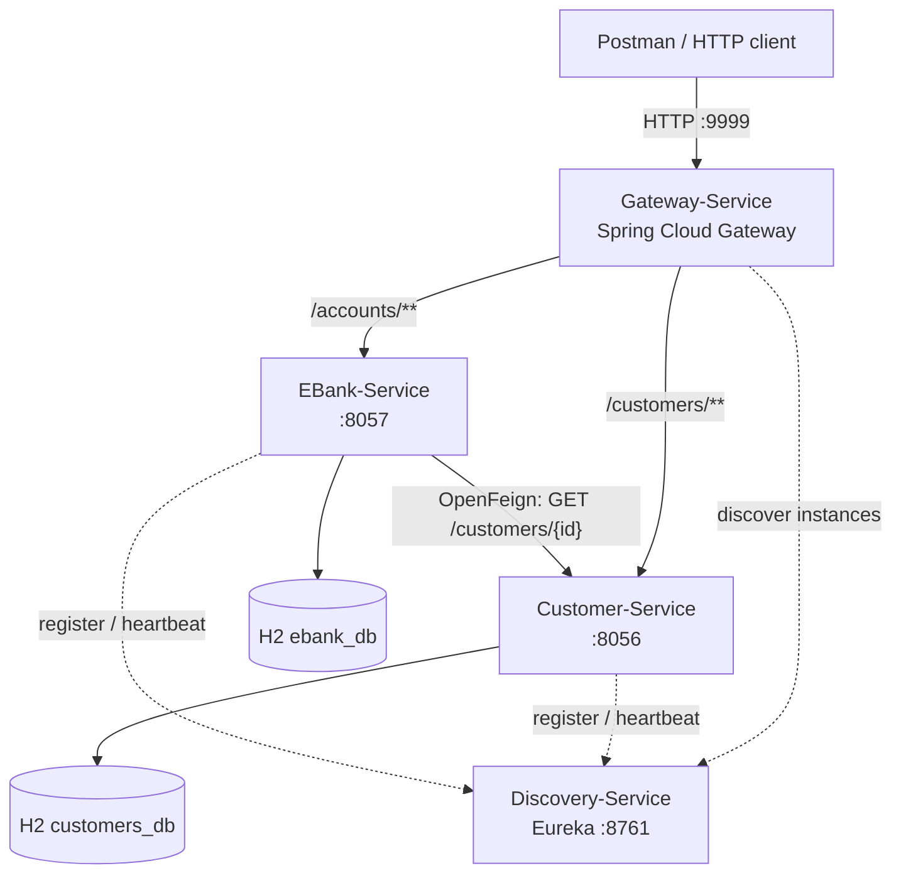

# Part I — Design and Implementation of an E-Banking Microservices System

**Academic technical report**  
**Module:** Microservices and Distributed Systems (*Microservices et systèmes distribués*)  
**Academic context:** BDCC S5, ENSET Mohammedia  
**Instructor:** Prof. Mohamed YOUSSFI  
**Project:** E-Bank — Part I  
**Implementation language:** Java 21  
**Frameworks:** Spring Boot 3.5.10 and Spring Cloud 2025.0.3  
**Repository:** [bdcc-s5-ebank-microservices](https://github.com/AbdelaliSaadali/bdcc-s5-ebank-microservices)  
**Document reference:** `main`, latest verified implementation commit [`3a56624`](https://github.com/AbdelaliSaadali/bdcc-s5-ebank-microservices/commit/3a56624624956ec93f08ca2a983275ee9ccb5458), 12 October 2026

> **Scope and evidence.** This report documents the source code verified in the GitHub repository and the development/testing activities reported during Part I. Example request bodies and responses are illustrative unless explicitly identified as code or configuration from the repository. Screenshots were collected locally on the developer's Desktop and are not embedded in this file. Compilation, launch, and manual Postman tests were performed during development; this report does not claim that a complete automated integration-test suite or production deployment was executed.

---

## Abstract

This practical project implements a distributed electronic-banking back end using a microservices architecture. The system separates customer management from bank-account management and introduces the infrastructure required for service registration, discovery, centralized HTTP routing, synchronous interservice communication, and fault tolerance. Four independently executable Spring Boot applications were developed: **Customer-Service**, **EBank-Service**, **Discovery-Service**, and **Gateway-Service**. Data persistence is handled separately by each business service using Spring Data JPA and an H2 in-memory database. Netflix Eureka provides service discovery, Spring Cloud Gateway acts as a single HTTP entry point, OpenFeign retrieves customer information from within EBank-Service, and Resilience4j supplies a circuit-breaker-backed fallback when the customer service cannot be reached.

The implementation was constructed incrementally and versioned in Git. Verification combined Maven compilation, database inspection, REST requests using Postman, Eureka dashboard observations, and a manual failure scenario. The resulting prototype demonstrates the essential mechanisms of distributed-service communication while deliberately remaining a local educational environment rather than a production banking platform.

**Keywords:** microservices, distributed systems, Spring Boot, Spring Cloud, REST, Eureka, API Gateway, OpenFeign, Resilience4j, circuit breaker, Spring Data JPA, H2, Java 21.

---

## 1. Introduction and objectives

### 1.1 Background

A monolithic application groups several business capabilities within one deployable unit. A microservices architecture decomposes those capabilities into applications that can be developed, started, and operated separately. This decomposition introduces additional problems: clients need a stable entry point, services need to locate one another, data ownership must remain clear, and failures of one service must not unnecessarily disable unrelated functions.

The E-Bank application serves as an educational example in which **customer information** and **bank-account information** are managed by distinct services. The project therefore addresses both ordinary application development (entities, persistence, business rules, REST APIs) and distributed-systems concerns (service discovery, routing, remote calls, and resilience).

### 1.2 Objectives

The objectives of Part I were to:

1. Construct independently runnable Spring Boot services with a layered organization.
2. Persist and retrieve customer and bank-account records through Spring Data JPA.
3. Publish HTTP REST endpoints with appropriate response codes for common operations.
4. Register business services with a Eureka service registry.
5. Expose customer and account APIs through one Spring Cloud Gateway endpoint.
6. Enable EBank-Service to fetch customer details from Customer-Service using OpenFeign.
7. Preserve account retrieval when Customer-Service becomes unavailable by introducing a Resilience4j-backed fallback.
8. Verify the application incrementally and track the implementation using meaningful Git commits.

### 1.3 Development approach

The work followed an **incremental, service-by-service workflow**. Each application was initialized with Spring Initializr and built using Maven. Domain entities and repositories were implemented before service methods and HTTP controllers. Infrastructure services were then introduced, followed by interservice communication and error-tolerant behavior. Compilation and functional checks were used at important milestones, and corresponding changes were committed to the Git repository.

This approach was selected to keep defects localized, make architectural responsibilities explicit, and preserve a chronological history of design decisions.

---

## 2. Conceptual foundations

### 2.1 Service boundaries and independent persistence

A service boundary identifies a coherent business responsibility. In this project:

- **Customer-Service** owns the customer domain: identifiers, names, and email addresses.
- **EBank-Service** owns the bank-account domain: account identifiers, balances, account types, creation dates, and references to customer identifiers.

Each service uses its **own H2 database instance**. The `customerId` field in EBank-Service is a logical reference to a customer managed elsewhere; it is not a cross-database JPA foreign-key relationship. Such separation illustrates data ownership in a distributed design, although it also means referential consistency is not automatically enforced between services.

### 2.2 Layered implementation

Both business applications use a layered design:

| Layer | Responsibility | Representative component |
|---|---|---|
| Domain/model | Represent business data | `Customer`, `BankAccount`, `AccountType` |
| Persistence | Encapsulate CRUD access through JPA | `CustomerRepository`, `BankAccountRepository` |
| Business/service | Enforce rules and coordinate operations | `CustomerService`, `EBankService` |
| HTTP/API | Translate requests and results to HTTP | `CustomerRestController`, `BankAccountRestController` |
| Integration | Communicate with a remote service | `CustomerRestClient` |

The separation reduces the direct coupling between HTTP handling, business decisions, and database operations.

### 2.3 REST and HTTP semantics

Spring MVC controllers expose resources through HTTP routes. The implementation uses:

- `GET` to retrieve collections or individual resources.
- `POST` to create a new resource.
- `200 OK` for successful retrieval.
- `201 Created` (with a `Location` header) for successful creation.
- `400 Bad Request` for business validation errors thrown as `IllegalArgumentException`.
- `404 Not Found` when an individual requested local resource is absent.

These conventions help clients interpret the outcome of requests without requiring knowledge of Java classes.

### 2.4 Service discovery

Hardcoding every service endpoint in every client creates configuration coupling. **Netflix Eureka** addresses this by maintaining a registry of available application instances. Services register under logical names such as `CUSTOMER-SERVICE` and `EBANK-SERVICE`, renew their registrations periodically, and can be discovered using those names.

The registry and the business services remain separate applications. Eureka provides discovery metadata; it does not store customers or bank accounts.

### 2.5 Gateway routing and load balancing

**Spring Cloud Gateway** receives client HTTP requests on a common port and chooses an upstream service according to HTTP request predicates, such as the URL path. This is **Layer 7 (application-layer) routing**: the decision depends on HTTP information, not only a transport-layer IP address and TCP/UDP port.

Gateway routes use `lb://<service-name>`. The `lb://` scheme invokes Spring Cloud LoadBalancer to select a discovered instance of the named service. During the verified experiment there was one running instance of each business service, so multi-instance traffic distribution was not demonstrated; the mechanism for resolving service instances was nevertheless present.

### 2.6 Synchronous calls and resilience

**OpenFeign** allows a Java interface to describe a remote HTTP call declaratively. EBank-Service requests a customer's details through that interface, using Eureka/LoadBalancer rather than embedding a fixed customer-service port.

A synchronous dependency also introduces failure propagation: if Customer-Service is unavailable, the remote operation can fail. **Resilience4j**, integrated through Spring Cloud Circuit Breaker, provides circuit-breaker behavior and permits a fallback response. The implemented fallback returns `null` for the unavailable customer while retaining the locally stored bank-account data.

---

## 3. Technologies and development environment

| Technology | Version or implementation | Role |
|---|---|---|
| Java | 21 | Programming language and JVM runtime |
| Spring Boot | **3.5.10** | Application bootstrap, configuration and embedded servers |
| Spring Cloud | **2025.0.3** release-train BOM | Compatible dependency management |
| Maven + Maven Wrapper | Wrapper included in each service | Dependency resolution and reproducible build commands |
| Spring Web / Spring MVC | Boot-managed | Business-service REST APIs |
| Spring Data JPA + Hibernate | Boot-managed | Persistence abstraction and entity mapping |
| H2 | In-memory database | Local persistence for each business service |
| Lombok | Maven-managed | Generated constructors, accessors and builders |
| Netflix Eureka | Spring Cloud Netflix | Registration and service discovery |
| Spring Cloud Gateway Server WebFlux | `4.3.5` observed during build | Reactive HTTP gateway |
| Spring Cloud OpenFeign | `4.3.3` observed during build | Declarative interservice HTTP client |
| Spring Cloud Circuit Breaker / Resilience4j | `3.3.3` / Resilience4j `2.2.0` observed during build | Fault-tolerance mechanism |
| Spring Boot Actuator | Boot-managed | Management endpoint support |
| JUnit 5 / AssertJ / Spring Boot Test | Boot-managed | Customer persistence and business tests |
| Postman | Local API-testing client | Functional HTTP verification |
| Git and GitHub | Repository on `main` | Incremental version history and source hosting |
| Visual Studio Code | Development environment | Editing, project generation and terminal execution |

All four `pom.xml` files use Spring Boot `3.5.10` and import the Spring Cloud `2025.0.3` dependency BOM. The dependency versions shown as “observed during build” are derived from the Maven output recorded during implementation, not manually pinned in each service's POM.

### 3.1 Application ports

| Application | Port | Main purpose |
|---|---:|---|
| `customer-service` | **8056** | Customer management |
| `ebank-service` | **8057** | Bank-account management |
| `discovery-service` | **8761** | Eureka registry and dashboard |
| `gateway-service` | **9999** | Public HTTP entry point for the two APIs |

---

## 4. Overall system architecture



**Figure 1.** Logical architecture of Part I. Solid arrows indicate application requests or data access; dashed arrows indicate service-discovery activity. A request to the Gateway is first routed to the appropriate business service. When retrieving one bank account, EBank-Service may issue an additional request to Customer-Service to enrich the response.

### 4.1 Typical account-retrieval sequence

1. A client sends `GET /accounts/{id}` to `localhost:9999`.
2. Gateway's account route matches the path and resolves `ebank-service` through the load-balancer/discovery mechanism.
3. EBank-Service queries `ebank_db` for the requested account.
4. EBank-Service extracts `customerId` and invokes the `CustomerRestClient` Feign interface.
5. OpenFeign resolves `customer-service` and sends `GET /customers/{id}`.
6. Customer-Service reads the record from `customers_db` and returns customer JSON.
7. EBank-Service attaches the deserialized customer DTO to the account and returns the combined HTTP response through Gateway.
8. If the customer call fails and the configured fallback is used, EBank-Service returns the account without customer details.

**Architectural distinction:** the account remains an EBank-owned database entity. The customer information attached to it is a response-time composition, not a replicated customer table in EBank's database.

---

## 5. Repository organization

The repository contains four separate Maven/Spring Boot projects rather than a single monolithic application. The principal files are:

```text
ebank/
├── customer-service/
│   ├── pom.xml
│   ├── mvnw, mvnw.cmd, .mvn/
│   └── src/
│       ├── main/
│       │   ├── java/com/abdelali/customerservice/
│       │   │   ├── CustomerServiceApplication.java
│       │   │   ├── entities/Customer.java
│       │   │   ├── repository/CustomerRepository.java
│       │   │   ├── service/CustomerService.java
│       │   │   └── web/{CustomerRestController,HelloController}.java
│       │   └── resources/application.properties
│       └── test/java/com/abdelali/customerservice/
│           ├── CustomerServiceApplicationTests.java
│           ├── repository/CustomerRepositoryTest.java
│           └── service/CustomerServiceTest.java
├── ebank-service/
│   ├── pom.xml
│   ├── mvnw, mvnw.cmd, .mvn/
│   └── src/main/
│       ├── java/com/abdelali/ebankservice/
│       │   ├── EbankServiceApplication.java
│       │   ├── entities/{BankAccount,AccountType}.java
│       │   ├── repository/BankAccountRepository.java
│       │   ├── service/EBankService.java
│       │   ├── web/BankAccountRestController.java
│       │   ├── model/Customer.java
│       │   └── clients/{CustomerRestClient,CustomerRestClientFallback}.java
│       └── resources/application.properties
├── discovery-service/
│   ├── pom.xml
│   ├── mvnw, mvnw.cmd, .mvn/
│   └── src/main/
│       ├── java/com/abdelali/discoveryservice/DiscoveryServiceApplication.java
│       └── resources/application.properties
└── gateway-service/
    ├── pom.xml
    ├── mvnw, mvnw.cmd, .mvn/
    └── src/main/
        ├── java/com/abdelali/gatewayservice/GatewayServiceApplication.java
        └── resources/application.properties
```

All Java package declarations begin at `com.abdelali...`; `src/main/java` is the Maven source directory and **must not** be included in Java `package` or `import` names.

---

## 6. Customer-Service: customer-domain microservice

### 6.1 Domain entity

The JPA entity `Customer` is defined in `customer-service/.../entities/Customer.java`. Its persistent attributes are:

| Attribute | Java type | Meaning |
|---|---|---|
| `id` | `Long` | Customer primary key, generated with `GenerationType.IDENTITY` |
| `name` | `String` | Customer's name |
| `email` | `String` | Customer's email address |

The entity uses `@Entity`, `@Id`, and `@GeneratedValue(strategy = GenerationType.IDENTITY)`. Lombok generates getters, setters, constructors, and a builder through its corresponding annotations. Thus the class represents both an object in Java and a relational table managed by Hibernate.

### 6.2 Persistence layer

`CustomerRepository` extends `JpaRepository<Customer, Long>`. Spring Data JPA supplies operations such as `save`, `findAll`, and `findById` without requiring a handwritten repository implementation.

```java
public interface CustomerRepository extends JpaRepository<Customer, Long> {
}
```

### 6.3 Business-service layer

`CustomerService` is a Spring `@Service` using constructor injection of `CustomerRepository`. It implements:

| Method | Function |
|---|---|
| `getAllCustomers()` | Retrieve all customers |
| `getCustomerById(Long id)` | Return an `Optional<Customer>` |
| `createCustomer(Customer customer)` | Validate required fields and persist a customer |

Before saving, `createCustomer` rejects a missing or blank `name` and a missing or blank `email` by raising `IllegalArgumentException`. Validation is performed in the service layer rather than being duplicated in the controller.

### 6.4 REST API

The `CustomerRestController` is annotated with `@RestController` and `@RequestMapping("/customers")`.

| Method | Path | Operation | Main response |
|---|---|---|---|
| `GET` | `/customers` | List customers | `200` and JSON array |
| `GET` | `/customers/{id}` | Get a customer | `200` or `404` |
| `POST` | `/customers` | Create a customer | `201`, `Location`, customer JSON; `400` if invalid |
| `GET` | `/hello` | Auxiliary smoke-test endpoint | `200` and a short string |

The `/hello` endpoint is implemented by the separate `HelloController`, and is not part of the main customer-resource contract.

An illustrative creation request is:

```http
POST http://localhost:8056/customers
Content-Type: application/json
```

```json
{
  "name": "Sara",
  "email": "sara@example.com"
}
```

### 6.5 Persistence configuration

The verified `application.properties` contains the following essential settings:

```properties
spring.application.name=customer-service
server.port=8056
spring.datasource.url=jdbc:h2:mem:customers_db
spring.datasource.driver-class-name=org.h2.Driver
spring.h2.console.enabled=true
spring.jpa.hibernate.ddl-auto=create-drop
spring.jpa.show-sql=true
eureka.client.service-url.defaultZone=http://localhost:8761/eureka/
```

`create-drop` lets Hibernate create the schema at startup and drop it at shutdown. Because the H2 database is in memory, data is temporary and **is lost when the service restarts**. This configuration is appropriate for laboratory work but is not durable storage.

### 6.6 Tests implemented in the repository

- `CustomerRepositoryTest`, annotated with `@DataJpaTest`, saves a customer, checks the generated identifier, reads the customer back, and asserts the expected name and email.
- `CustomerServiceTest`, annotated with `@SpringBootTest` and `@Transactional`, checks normal creation/retrieval and rejects a customer whose name is absent.
- `CustomerServiceApplicationTests` supplies a Spring application-context smoke test.

These tests demonstrate focused persistence and service-layer checks. They do not constitute a complete end-to-end or coverage-measured test suite.

---

## 7. EBank-Service: bank-account microservice

### 7.1 BankAccount entity and account type

`BankAccount` is an independent JPA entity with a String primary key. Its persistent fields are:

| Attribute | Java type | Description |
|---|---|---|
| `id` | `String` | UUID-generated account identifier |
| `createdAt` | `Date` | Creation timestamp |
| `balance` | `Double` | Account balance |
| `type` | `AccountType` | Account classification |
| `customerId` | `Long` | Logical reference to Customer-Service |

`AccountType` defines exactly two values:

```java
public enum AccountType {
    CURRENT_ACCOUNT,
    SAVING_ACCOUNT
}
```

The account type is stored by name through `@Enumerated(EnumType.STRING)`, which avoids relying on numeric enum positions in the database.

After the OpenFeign integration, the entity also contains:

```java
@Transient
private Customer customer;
```

Here `Customer` is an EBank-side **data transfer object**, and `@Transient` is a JPA annotation: Hibernate does not persist this attribute. It can nevertheless be serialized into the REST response after EBank-Service retrieves its value remotely.

### 7.2 Persistence layer

`BankAccountRepository` extends `JpaRepository<BankAccount, String>` and declares a derived query method:

```java
List<BankAccount> findByCustomerId(Long customerId);
```

Spring Data JPA interprets the method name and produces a query filtering bank accounts by the `customerId` field. This illustrates the use of generated repository queries instead of manually written SQL.

### 7.3 Business-service layer

`EBankService` encapsulates these operations:

| Method | Role |
|---|---|
| `getAllAccounts()` | List locally stored bank accounts |
| `getAccountById(String id)` | Retrieve an account and enrich it with customer details using Feign |
| `getAccountsByCustomerId(Long customerId)` | Filter accounts by customer identifier |
| `createAccount(BankAccount account)` | Validate and persist a new account |

The `createAccount` method enforces that:

1. `balance` is not `null`, is nonnegative, and is finite (`Double.isFinite`).
2. `customerId` is supplied.
3. `type` is supplied.

It then generates the creation timestamp with `new Date()`, generates the account identifier with `UUID.randomUUID().toString()`, and persists the record through the repository.

**Design observation:** `customerId` is required but its existence in Customer-Service is not validated during account creation. The interservice lookup occurs when the individual account is retrieved.

### 7.4 REST API

The account controller is mapped to `/accounts`.

| Method | Path | Operation | Main response |
|---|---|---|---|
| `GET` | `/accounts` | List all accounts | `200` and JSON array |
| `GET` | `/accounts/{id}` | Get one account, optionally enriched with customer | `200` or `404` for missing local account |
| `GET` | `/accounts/customer/{customerId}` | List accounts belonging to one customer ID | `200` and JSON array |
| `POST` | `/accounts` | Create account | `201` and `Location`; `400` for defined validation errors |

An illustrative account-creation request is:

```http
POST http://localhost:8057/accounts
Content-Type: application/json
```

```json
{
  "balance": 15000.0,
  "type": "CURRENT_ACCOUNT",
  "customerId": 1
}
```

The generated account identifier must be read from the creation response; it is not known beforehand.

### 7.5 EBank persistence configuration

```properties
spring.application.name=ebank-service
server.port=8057
spring.datasource.url=jdbc:h2:mem:ebank_db
spring.datasource.driver-class-name=org.h2.Driver
spring.h2.console.enabled=true
spring.jpa.hibernate.ddl-auto=create-drop
spring.jpa.show-sql=true
eureka.client.service-url.defaultZone=http://localhost:8761/eureka/
spring.cloud.openfeign.circuitbreaker.enabled=true
```

The last two properties were added in later stages: Eureka-based discovery and circuit-breaker integration for Feign. EBank-Service remains responsible for its own database schema and data.

---

## 8. Discovery-Service: Netflix Eureka

### 8.1 Purpose

Initially, Customer-Service and EBank-Service could only be addressed by their known host-and-port combinations. The project then introduced a standalone service registry to avoid making service-to-service integrations dependent on manually maintained endpoint addresses.

### 8.2 Implementation

`DiscoveryServiceApplication` uses `@SpringBootApplication` and `@EnableEurekaServer`. Its principal Maven dependency is `spring-cloud-starter-netflix-eureka-server`.

The configuration is:

```properties
spring.application.name=discovery-service
server.port=8761
eureka.client.register-with-eureka=false
eureka.client.fetch-registry=false
```

Setting both Eureka client flags to `false` prevents the standalone registry from behaving as a normal client trying to register itself with another Eureka server or fetch another registry.

### 8.3 Registration of business services

Both Customer-Service and EBank-Service include the Eureka Client starter and specify:

```properties
eureka.client.service-url.defaultZone=http://localhost:8761/eureka/
```

Their registration was verified using the Eureka dashboard at `http://localhost:8761`. The dashboard showed `CUSTOMER-SERVICE` and `EBANK-SERVICE` with status **UP**. Subsequently, `GATEWAY-SERVICE` was also registered.

**Interpretation:** an `UP` registration shows the registry's current view of instance availability. It does not, by itself, guarantee that every application endpoint or downstream dependency is functioning correctly. Functional API requests were therefore tested separately.

### 8.4 Self-preservation warning

A Eureka dashboard warning concerning low heartbeat renewal counts was observed during local testing. Eureka's self-preservation behavior can retain registrations when renewal frequency is unexpectedly low, reducing the risk of deleting healthy instances during communication problems. Consequently, the presence of a registration should be interpreted alongside direct endpoint verification. The project did not disable self-preservation merely to conceal this warning.

---

## 9. Gateway-Service: centralized entry point

### 9.1 Motivation

Without a gateway, a client must know that customers are served on port `8056` and accounts on port `8057`. Gateway-Service supplies a common entry point on port `9999`, while the internal services continue to run independently.

### 9.2 Dependencies and runtime model

Gateway-Service uses `spring-cloud-starter-gateway-server-webflux`, the Eureka Client starter, and Spring Boot Actuator. It is a **reactive WebFlux-based Gateway**, whereas the two business services use Spring MVC. The observed application runtime therefore uses Reactor Netty for Gateway rather than the MVC/Tomcat stack used by the business APIs.

### 9.3 Routes

The verified `gateway-service/src/main/resources/application.properties` defines:

```properties
spring.application.name=gateway-service
server.port=9999

eureka.client.service-url.defaultZone=http://localhost:8761/eureka/

spring.cloud.gateway.server.webflux.routes[0].id=customer-service-route
spring.cloud.gateway.server.webflux.routes[0].uri=lb://customer-service
spring.cloud.gateway.server.webflux.routes[0].predicates[0]=Path=/customers,/customers/**

spring.cloud.gateway.server.webflux.routes[1].id=ebank-service-route
spring.cloud.gateway.server.webflux.routes[1].uri=lb://ebank-service
spring.cloud.gateway.server.webflux.routes[1].predicates[0]=Path=/accounts,/accounts/**
```

For Spring Cloud Gateway `4.3.x`, the configuration uses the `spring.cloud.gateway.server.webflux.routes` prefix.

| Incoming request on `:9999` | Matched route | Destination |
|---|---|---|
| `/customers` or `/customers/**` | `customer-service-route` | `lb://customer-service` |
| `/accounts` or `/accounts/**` | `ebank-service-route` | `lb://ebank-service` |

The path is forwarded without removing its leading resource segment because the existing controllers already use `/customers` and `/accounts`. There is no custom `StripPrefix` filter in the verified configuration.

### 9.4 Role of the `lb://` URI

The `lb://` scheme activates logical-name resolution and client-side load balancing through Spring Cloud. The route identifies a **service**, not a fixed destination address. With several registered instances, the load balancer could select among them according to its configured algorithm. In the laboratory setup, one instance of each business service was used, so the experiment validated routing and discovery rather than measured multi-instance balancing.

---

## 10. OpenFeign: communication between microservices

### 10.1 Business need

The bank-account database stores `customerId`, but not the customer's name or email. To produce a richer account response, EBank-Service must request those fields from Customer-Service.

This is a **synchronous request/response integration**: EBank-Service waits for an HTTP response from Customer-Service while processing the account lookup.

### 10.2 Enabling declarative HTTP clients

EBank-Service adds the `spring-cloud-starter-openfeign` dependency and annotates `EbankServiceApplication` with `@EnableFeignClients`. Spring then discovers Feign interfaces and creates client implementations.

### 10.3 Customer DTO

The EBank-side `model.Customer` class contains `id`, `name`, and `email`. It is a plain Java transfer model using Lombok, not a JPA entity. It is independent of the Customer-Service source code and populated from JSON returned by the remote API.

### 10.4 CustomerRestClient interface

The essential Feign contract is:

```java
@FeignClient(
    name = "customer-service",
    fallback = CustomerRestClientFallback.class
)
public interface CustomerRestClient {
    @GetMapping("/customers/{id}")
    Customer getCustomerById(@PathVariable("id") Long id);
}
```

The `name` refers to the Eureka-registered service, and the `@GetMapping` path matches the existing Customer-Service endpoint. The fallback attribute was introduced in the subsequent Resilience4j phase.

### 10.5 Enriching an account

The service method uses repository retrieval followed by an optional mapping operation:

```java
public Optional<BankAccount> getAccountById(String id) {
    return bankAccountRepository.findById(id)
        .map(account -> {
            Customer customer = customerRestClient
                .getCustomerById(account.getCustomerId());
            account.setCustomer(customer);
            return account;
        });
}
```

This operation has two distinct data sources: the account comes from EBank's H2 database, while the `customer` property comes from a remote service. If the **local account** is not found, `Optional.empty()` allows the controller to respond with `404` without attempting the remote call.

### 10.6 Illustrative enriched response

After creating a customer and an account using its actual identifier, a successful account lookup can return a representation such as:

```json
{
  "id": "<generated-account-uuid>",
  "createdAt": "<generated-date-time>",
  "balance": 15000.0,
  "type": "CURRENT_ACCOUNT",
  "customerId": 1,
  "customer": {
    "id": 1,
    "name": "Sara",
    "email": "sara@example.com"
  }
}
```

The UUID, date, and customer identifier above are illustrative placeholders or sample values, not a preserved Postman response. The development workflow reported that the nested customer data was obtained successfully through the Gateway endpoint.

---

## 11. Resilience4j: circuit breaker and fallback

### 11.1 Failure scenario

A direct Feign call introduces a runtime dependency on Customer-Service. If Customer-Service is down, slow, or unreachable, the account lookup would otherwise risk returning an error even though the bank-account record exists locally.

The resilience requirement was therefore: **continue serving EBank-owned account information when customer enrichment cannot be completed**.

### 11.2 Dependencies and configuration

EBank-Service adds:

```xml
<dependency>
    <groupId>org.springframework.cloud</groupId>
    <artifactId>spring-cloud-starter-circuitbreaker-resilience4j</artifactId>
</dependency>
```

Feign circuit-breaker integration is enabled through:

```properties
spring.cloud.openfeign.circuitbreaker.enabled=true
```

The Feign interface specifies the fallback implementation using its `fallback` attribute.

### 11.3 Fallback class

`CustomerRestClientFallback` implements the same contract as the remote client:

```java
@Component
public class CustomerRestClientFallback implements CustomerRestClient {
    @Override
    public Customer getCustomerById(Long id) {
        return null;
    }
}
```

When the protected Feign invocation fails and the fallback is applied, the result of customer enrichment is `null`. EBank-Service can still serialize the original account. The fallback is intentionally minimal and appropriate to the educational demonstration.

### 11.4 Circuit-breaker states

A conventional circuit breaker distinguishes:

- **CLOSED:** calls are permitted and their outcomes are observed.
- **OPEN:** calls are temporarily rejected to prevent repeated attempts against a failing dependency.
- **HALF-OPEN:** limited trial calls are permitted to determine whether normal operation can resume.

These states describe the resilience mechanism. **The specific internal state transitions and failure-rate metrics were not measured or recorded in this project**; the practical test verified the externally visible fallback behavior.

### 11.5 Failure experiment and result

The manual verification procedure was:

1. Start Discovery-Service, Customer-Service, EBank-Service, and Gateway-Service.
2. Create a customer and an associated bank account.
3. Request the account by ID; verify that it contains nested customer information.
4. Stop **only Customer-Service**, leaving EBank-Service running so its in-memory account remains available.
5. Request the same account again through Gateway.
6. Verify that the bank-account data is still returned even though the customer information is unavailable.

The developer reported that this failure test succeeded. An illustrative degraded response is:

```json
{
  "id": "<generated-account-uuid>",
  "balance": 15000.0,
  "type": "CURRENT_ACCOUNT",
  "customerId": 1,
  "customer": null
}
```

Other fields, notably `createdAt`, remain part of the actual entity; they are omitted from this shortened illustration for readability. The fallback test was **not captured as a screenshot**, although the functional result was reported as successful.

### 11.6 Interpretation and limitations of this fallback

The account domain remains available under a failure of the remote customer domain: this is **graceful degradation**, rather than complete restoration of customer data. However, returning `null` does not distinguish a missing customer (`404` from Customer-Service) from network unavailability or other remote errors. A production implementation should adopt an explicit error policy, more informative fallback metadata, timeouts, observability, and targeted exception handling.

---

## 12. Installation, execution, and reproduction

### 12.1 Prerequisites

- JDK **21**, correctly selected by the terminal/IDE.
- An internet connection for the first Maven dependency download.
- Git, for cloning the repository.
- Four available TCP ports: `8761`, `8056`, `8057`, and `9999`.
- Postman or another HTTP client for functional verification.

### 12.2 Obtain the source code

```bash
git clone https://github.com/AbdelaliSaadali/bdcc-s5-ebank-microservices.git
cd bdcc-s5-ebank-microservices
```

The `./mvnw` Maven Wrapper is provided inside each individual service. There is **no single root-level Maven multi-module build** in the verified repository.

### 12.3 Compile and start each application

Launch each command in **its own terminal**, ideally in the following order:

**Terminal A — Eureka:**

```bash
cd discovery-service
./mvnw clean compile
./mvnw spring-boot:run
```

**Terminal B — Customers:**

```bash
cd customer-service
./mvnw clean compile
./mvnw spring-boot:run
```

**Terminal C — EBank:**

```bash
cd ebank-service
./mvnw clean compile
./mvnw spring-boot:run
```

**Terminal D — Gateway:**

```bash
cd gateway-service
./mvnw clean compile
./mvnw spring-boot:run
```

Each block assumes that the terminal begins at the **repository root**. When using the same terminal for a different service, navigate to the correct directory first. Compilation success is evidenced by `BUILD SUCCESS`; runtime readiness also requires observing the service startup message.

The Eureka dashboard is accessible at **http://localhost:8761**. After startup and registration, it should list the participating client applications.

### 12.4 Reproducible API walkthrough

The Gateway should be running before executing the following requests.

**A. Create a customer:**

```bash
curl -i -X POST http://localhost:9999/customers \
  -H 'Content-Type: application/json' \
  -d '{"name":"Sara","email":"sara@example.com"}'
```

Copy the generated `id` from the response; do not assume that it is always `1`.

**B. Create an account linked to the returned customer ID:**

```bash
curl -i -X POST http://localhost:9999/accounts \
  -H 'Content-Type: application/json' \
  -d '{"balance":15000.0,"type":"CURRENT_ACCOUNT","customerId":1}'
```

Replace `1` with the actual customer ID. Record the newly generated account UUID from the response.

**C. Retrieve the enriched account:**

```bash
curl -i http://localhost:9999/accounts/<account-uuid>
```

Replace `<account-uuid>` with the UUID returned by the account-creation request. Verify that the account includes its corresponding `customer` object.

**D. Test degraded behavior:**

Stop Customer-Service with `Ctrl+C` in its terminal **without stopping or restarting EBank-Service**, then repeat request C. Verify that the account is returned while the customer field is unavailable.

**Important:** The database is in-memory. Restarting EBank-Service removes the account used for this experiment. Restarting Customer-Service removes previously created customer records. Recreate test data after such restarts.

### 12.5 Local H2 inspection

With the respective service running and `spring.h2.console.enabled=true`, the H2 consoles are accessible at:

- Customer-Service: `http://localhost:8056/h2-console`, JDBC URL `jdbc:h2:mem:customers_db`.
- EBank-Service: `http://localhost:8057/h2-console`, JDBC URL `jdbc:h2:mem:ebank_db`.

These are development tools and are not intended to be publicly exposed in a production banking deployment.

---

## 13. Verification, results, and evidence

### 13.1 Functional and build verification

The following results summarize the documented development sessions. “Observed” refers to supplied terminal output/screenshots; “reported” refers to the developer's confirmation when no output was preserved in this report.

| Verification activity | Evidence level | Outcome |
|---|---|---|
| Customer persistence and service tests | Present as JUnit source files; earlier test milestones reported | Implemented; focused assertions available in repository |
| Customer REST endpoints | Manual Postman work reported | CRUD subset implemented and tested |
| EBank REST endpoints | Manual Postman work reported | Account operations implemented and tested |
| Discovery-Service Maven build | Observed terminal `BUILD SUCCESS` | Successful compilation |
| Discovery-Service startup | Observed startup log and dashboard | Registry launched on `8761` |
| Customer-Service registration | Observed Eureka dashboard | Instance shown `UP` |
| Customer-Service and EBank-Service registration | Observed Eureka dashboard | Both shown `UP` |
| Gateway-Service build and routing | Observed build; HTTP tests reported, screenshots captured locally | Gateway configured and reportedly working |
| OpenFeign integration | Observed EBank compilation and startup; HTTP result reported | Customer enrichment reportedly working |
| Circuit-breaker/fallback dependency compilation | Observed EBank `BUILD SUCCESS` | Dependency setup compiled |
| Customer-Service stopped during account retrieval | Developer-reported successful manual test | Account retrieval continued through fallback |
| Commit/push history | Verified on GitHub | Source changes stored on `main` |

**Evidence boundary:** successful `mvnw clean compile` confirms Java compilation, **not** execution of JUnit tests. Similarly, successful startup confirms the application starts, but the functional behavior of each route is evidenced by separate HTTP tests. The final fallback behavior was reported successful; no screenshot was retained for that specific scenario.

### 13.2 Suggested organization of the screenshots

The images recorded during development can be organized in the final submission as:

| Figure | Subject | Evidence purpose |
|---|---|---|
| 1 | Customer-Service POST and GET in Postman | Resource creation and retrieval |
| 2 | Customer H2 console or persistence demonstration | Independent customer persistence |
| 3 | EBank-Service POST and GET in Postman | Bank-account operations |
| 4 | Eureka dashboard before registration | Successful registry startup |
| 5 | Eureka showing Customer-Service `UP` | First client registration |
| 6 | Eureka showing both business services `UP` | Discovery of multiple applications |
| 7 | Eureka showing Gateway-Service | Gateway registration |
| 8 | Gateway `GET /customers` and `GET /accounts` | Unified API entry point |
| 9 | Enriched account with nested customer JSON | OpenFeign interservice call |
| — | Resilience4j degraded response | Test performed; **no screenshot captured** |

This table is a **recommended presentation order**, not a claim that every listed filename or screenshot is stored in the repository. The project screenshots were kept locally on the developer's Desktop.

---

## 14. Git versioning and incremental development

The codebase was built in deliberately separated steps. Git commit messages describe the technical milestone implemented at each stage.

| Chronology | Commit | Main development milestone |
|---:|---|---|
| 1 | [`22a4959`](https://github.com/AbdelaliSaadali/bdcc-s5-ebank-microservices/commit/22a49590bf4a5aa356c9028ca9ab9eb05cf70c0a) | Initialize Customer-Service |
| 2 | [`60b8414`](https://github.com/AbdelaliSaadali/bdcc-s5-ebank-microservices/commit/60b84142fa94a09c7533a146dc572757818651d1) | Configure Spring Boot and H2 |
| 3 | [`ff3dc78`](https://github.com/AbdelaliSaadali/bdcc-s5-ebank-microservices/commit/ff3dc78351b3ef03ab7a9c5a1b967619defd14d6) | Define Customer entity |
| 4 | [`50be6a2`](https://github.com/AbdelaliSaadali/bdcc-s5-ebank-microservices/commit/50be6a288e13de9730f75ffffa4f98db209937f3) | Implement/test Customer repository |
| 5 | [`aa49e87`](https://github.com/AbdelaliSaadali/bdcc-s5-ebank-microservices/commit/aa49e87e263d1c46b684f799e012d4dfe3435929) | Implement/test Customer business service |
| 6 | [`7105abd`](https://github.com/AbdelaliSaadali/bdcc-s5-ebank-microservices/commit/7105abd5f04d634dcb97e290e2e7cf335b320a5b) | Expose Customer REST endpoints |
| 7 | [`8c4081f`](https://github.com/AbdelaliSaadali/bdcc-s5-ebank-microservices/commit/8c4081f5afe62266c5da9db5e40ac8bc378ef2ec) | Initialize EBank-Service and BankAccount entity |
| 8 | [`4aaf85e`](https://github.com/AbdelaliSaadali/bdcc-s5-ebank-microservices/commit/4aaf85e4963d41dd70a8da346469c67620c8e715) | Implement BankAccount repository |
| 9 | [`0cdef11`](https://github.com/AbdelaliSaadali/bdcc-s5-ebank-microservices/commit/0cdef1136d0caac194ffa1051ae4ee16d2558c7f) | Implement EBank business rules |
| 10 | [`a6cd4a1`](https://github.com/AbdelaliSaadali/bdcc-s5-ebank-microservices/commit/a6cd4a16ffd85aa512d7d3bce8f19b20676658fa) | Expose bank-account REST endpoints |
| 11 | [`9b0b3a3`](https://github.com/AbdelaliSaadali/bdcc-s5-ebank-microservices/commit/9b0b3a36d9d8ab388703641781c1cccfde9d2953) | Configure and launch Eureka Server |
| 12 | [`0a07a4c`](https://github.com/AbdelaliSaadali/bdcc-s5-ebank-microservices/commit/0a07a4c4f27a87e8fb93abb371c49fc10e5b0465) | Register Customer-Service with Eureka |
| 13 | [`8958fa4`](https://github.com/AbdelaliSaadali/bdcc-s5-ebank-microservices/commit/8958fa4b849e3ab4bb9cf788dc5e5eb119410789) | Register EBank-Service with Eureka |
| 14 | [`08bf4b4`](https://github.com/AbdelaliSaadali/bdcc-s5-ebank-microservices/commit/08bf4b4fa846057602bc8beae621fa1ec3f28b1c) | Implement Eureka-aware API Gateway |
| 15 | [`7428eb9`](https://github.com/AbdelaliSaadali/bdcc-s5-ebank-microservices/commit/7428eb9cdef74fe64e8fd58315713b7a7483d823) | Integrate OpenFeign customer communication |
| 16 | [`3a56624`](https://github.com/AbdelaliSaadali/bdcc-s5-ebank-microservices/commit/3a56624624956ec93f08ca2a983275ee9ccb5458) | Add Resilience4j and customer-service fallback |

The commit sequence traces the progression from **local persistence and REST** toward **distributed discovery, gateway routing, interservice invocation, and resilience**. This chronological separation also improves the auditability of the implementation.

---

## 15. Issues encountered and technical lessons

### 15.1 Incorrect working directory

A build was initially executed inside the wrong Maven project. Because the projects are independent, a `BUILD SUCCESS` line only validates the artifact named in the Maven header. Later, attempting `cd ebank-service` while already inside that directory caused a harmless “no such file or directory” error.

**Lesson:** verify both the terminal's current working directory and the Maven artifact identifier before interpreting results.

### 15.2 Java import naming

During the Feign integration, imports that began with `main.java.com...` caused compilation errors. The correct import root is `com.abdelali...`, because Maven treats `src/main/java` as the source directory.

**Lesson:** distinguish the physical file path from the Java package name.

### 15.3 Framework-version compatibility

Project generation initially offered a newer Spring Boot series than the one selected for the practical work. The services were aligned to **Spring Boot 3.5.10** and **Spring Cloud 2025.0.3**, and Gateway used the property prefix appropriate to its Spring Cloud version.

**Lesson:** dependency compatibility and configuration namespaces matter in a distributed Java stack.

### 15.4 Multiple running processes and ephemeral data

Each application must occupy its own terminal/process and port. Repeatedly restarting H2-backed services removes previous test data, potentially causing requests to fail because an expected customer or bank account no longer exists.

**Lesson:** separate a service-connectivity failure from a test-data lifecycle issue.

### 15.5 Git staging versus local screenshots

A Git command pointing to `livrables/partie-1/...` initially failed because the screenshot path did not exist inside the working tree. The screenshots were instead kept on the Desktop. Subsequent source-code commits were verified in the remote repository.

**Lesson:** Git can only stage files that exist at the paths specified inside or relative to the repository. Deliverable storage should be explicitly planned.

---

## 16. Limits of the prototype and possible extensions

Part I demonstrates the core architecture; it is not a production-ready banking system. Important limitations include:

1. **Volatile persistence:** H2's in-memory mode loses all data when applications stop. PostgreSQL or another durable database would be required for long-lived environments.
2. **Cross-service integrity:** EBank-Service stores customer IDs without a database-level foreign key to Customer-Service. Customer existence and lifecycle consistency would require explicit domain policies.
3. **Minimal validation:** The implemented checks cover required fields and some balance constraints but do not constitute comprehensive input validation (e.g., email format, customer lifecycle, or domain-specific banking restrictions).
4. **Simplistic fallback:** A missing customer and a temporarily unreachable service may both lead to `customer: null`. More explicit failure semantics would improve client behavior.
5. **Limited automated testing:** Focused Customer tests exist, but the project does not include comprehensive automated contract tests, resilience tests, concurrency tests, or measured test coverage.
6. **No demonstrated scaling benchmark:** The Gateway and Eureka integration support instance discovery, but multiple service replicas and load-distribution metrics were not tested.
7. **No security boundary:** Authentication, authorization, secret handling, and audit requirements suitable for real financial systems are outside the demonstrated implementation.
8. **No production observability/deployment:** Container orchestration, distributed tracing, centralized log aggregation, and production monitoring were not implemented as part of the verified scope.
9. **Swagger/OpenAPI not implemented:** The verified final repository does not contain a Springdoc/Swagger integration. If explicit API documentation is required by the course assessment, this remains separate work.

These limitations provide a roadmap for subsequent extensions without diminishing the value of the completed architectural demonstration.

---

## 17. Conclusion

Part I achieved its principal educational objective: the construction and verification of a small but coherent distributed banking application using the Spring ecosystem. Customer-Service and EBank-Service were implemented as separate persistent business services with layered APIs. Netflix Eureka added logical-name-based discovery, while Spring Cloud Gateway provided one HTTP entry point for client requests. OpenFeign enabled EBank-Service to obtain remote customer information at request time, and a Resilience4j-backed fallback allowed account data to remain available during a reported Customer-Service outage.

The practical exercise also clarified important architectural distinctions: **service registration is not the same as endpoint health; Gateway routing is not the same as load-balancer instance selection; a remote customer DTO is not a shared JPA entity; and functional fallback behavior is not evidence of every internal circuit-breaker state transition**. Finally, the incremental commit history and manual verification sequence make the implementation understandable, reproducible, and suitable as a foundation for more advanced distributed-systems topics.

**Final status:** the four-service architecture, Eureka registration, Gateway routing, OpenFeign integration, and Resilience4j fallback were implemented. The developer reported successful functional testing and pushed the final changes to GitHub. Swagger/OpenAPI and production-hardening features were not part of the verified completed scope.

---

## References and primary source material

### Project primary sources

1. [E-Bank GitHub repository](https://github.com/AbdelaliSaadali/bdcc-s5-ebank-microservices) — verified source code and history.
2. [Customer-Service implementation](https://github.com/AbdelaliSaadali/bdcc-s5-ebank-microservices/tree/main/customer-service) — entity, JPA repository, service, controllers, tests and configuration.
3. [EBank-Service implementation](https://github.com/AbdelaliSaadali/bdcc-s5-ebank-microservices/tree/main/ebank-service) — account domain, REST API, OpenFeign and fallback.
4. [Discovery-Service implementation](https://github.com/AbdelaliSaadali/bdcc-s5-ebank-microservices/tree/main/discovery-service) — Eureka Server and standalone configuration.
5. [Gateway-Service implementation](https://github.com/AbdelaliSaadali/bdcc-s5-ebank-microservices/tree/main/gateway-service) — path predicates and `lb://` routing.
6. [Verified final Part I commit](https://github.com/AbdelaliSaadali/bdcc-s5-ebank-microservices/commit/3a56624624956ec93f08ca2a983275ee9ccb5458) — Resilience4j integration.

### Framework documentation for further study

7. [Spring Boot Reference Documentation](https://docs.spring.io/spring-boot/reference/).
8. [Spring Data JPA Reference](https://docs.spring.io/spring-data/jpa/reference/).
9. [Spring Cloud Netflix Reference](https://docs.spring.io/spring-cloud-netflix/reference/).
10. [Spring Cloud Gateway Reference](https://docs.spring.io/spring-cloud-gateway/reference/).
11. [Spring Cloud OpenFeign Reference](https://docs.spring.io/spring-cloud-openfeign/reference/).
12. [Resilience4j documentation](https://resilience4j.readme.io/docs).

*Prepared as an academic explanation of the completed Part I implementation. The report is intended to be placed at the root of the E-Bank repository, where its relative project paths and structure remain meaningful.*
